# Data model

The D1 (SQLite) schema of the whole product, defined with Drizzle in `packages/db/src/schema/*` and migrated by `packages/db/migrations/*`. The binding source is spec §5 ([docs/superpowers/specs/2026-09-29-cloudflare-rewrite-design.md](superpowers/specs/2026-09-29-cloudflare-rewrite-design.md#5-data-model-d1--drizzle)); this page is the reference for the tables as built.

## Conventions

- **Names:** snake_case in SQL, camelCase in TS (explicit column names, for example `emailVerified: integer("email_verified", …)`). Better Auth tables keep Better Auth's field names as TS keys, which its Drizzle adapter maps by.
- **Ids:** `text` primary keys from `newId()` (`crypto.randomUUID()`, `@smog/utils`); Better Auth tables use Better Auth's generator. Join tables have composite primary keys instead of ids.
- **Legacy ids:** `user`, `category`, `gesture` and `sponsorship` have `legacy_id` (unique, nullable), the Convex `_id`, for redirects and idempotent `INSERT … ON CONFLICT(legacy_id)` re-runs of the migration (spec §15). The other migrated rows get deterministic ids derived from their Convex ids, so their re-runs are idempotent on the primary key.
- **Timestamps:** integer epoch milliseconds in SQL, `Date` in TS (`integer({ mode: "timestamp_ms" })`, see DECISIONS). `created_at`/`updated_at` default to now in TS (`$defaultFn`; `updated_at` also `$onUpdate`); the service layer may set them explicitly. There are no SQL defaults for them. Nullable timestamps mark state: `published_at`, `revoked_at`, `used_at`, `paid_at`, … (no `is_active` booleans).
- **Booleans:** `integer({ mode: "boolean" })` (0/1).
- **Enums:** `text` columns with a `CHECK (col IN (…))` generated from the `const` arrays in `packages/db/src/enums.ts`. Adding a value is a schema change (`bun -F @smog/db db:generate`; SQLite rebuilds the table).
- **JSON:** `text({ mode: "json" })` (`audit_log.data`, `sponsorship_event.data`, `render_job.input`), always validated by a Zod schema at the service boundary.
- **Foreign keys:** every one has an explicit `ON DELETE` rule (below). Every FK column, and every column that the planned queries and crons (spec §8.1) filter or sort by, has an index. `gesture_fts.gesture_id` is the one exception (see the FTS notes). Uniqueness is enforced by the database.
- **Length limits** from the spec are `CHECK (length(col) BETWEEN …)` constraints as well as Zod rules.

## Diagram

Key columns are marked (PK, FK, UK = unique). The labels are the `ON DELETE` rules.

```mermaid
erDiagram
  user ||--o{ session : "cascade"
  user ||--o{ account : "cascade"
  user ||--o{ passkey : "cascade"
  user ||--o{ favorite : "cascade"
  user ||--o{ list : "owns (cascade)"
  user |o--o{ list_item : "added_by (set null)"
  user |o--o{ list_share : "created_by (set null)"
  user ||--o{ consent_event : "cascade"
  user |o--o{ audit_log : "actor (set null)"
  user |o--o{ sponsorship_event : "actor (set null)"
  gesture ||--o{ gesture_category : "cascade"
  category ||--o{ gesture_category : "cascade"
  gesture ||--o{ gesture_keyword : "cascade"
  gesture ||--o{ favorite : "cascade"
  gesture ||--o{ list_item : "cascade"
  gesture ||--o| gesture_fts : "indexed by (no FK)"
  list ||--o{ list_item : "cascade"
  list ||--o{ list_share : "cascade"
  sponsor ||--o| invoice_request : "cascade"
  sponsor ||--o{ sponsorship : "restrict"
  gesture ||--o{ sponsorship : "restrict"
  payment ||--o{ payment_item : "cascade"
  sponsorship ||--o{ payment_item : "restrict"
  sponsorship ||--o{ render_job : "cascade"
  sponsorship ||--o{ sponsorship_event : "cascade"
  sponsorship ||--o{ sponsorship_token : "cascade"
  user {
    text id PK
    text name
    text email UK
    integer email_verified
    text image
    integer created_at
    integer updated_at
    text role
    integer banned
    text ban_reason
    integer ban_expires
    text locale
    text legacy_id UK
    integer welcomed_at
  }
  session {
    text id PK
    integer expires_at
    text token UK
    integer created_at
    integer updated_at
    text ip_address
    text user_agent
    text user_id FK
    text impersonated_by
  }
  account {
    text id PK
    text account_id
    text provider_id
    text user_id FK
    text access_token
    text refresh_token
    text id_token
    integer access_token_expires_at
    integer refresh_token_expires_at
    text scope
    text password
    integer created_at
    integer updated_at
  }
  verification {
    text id PK
    text identifier
    text value
    integer expires_at
    integer created_at
    integer updated_at
  }
  passkey {
    text id PK
    text name
    text public_key
    text user_id FK
    text credential_id
    integer counter
    text device_type
    integer backed_up
    text transports
    integer created_at
    text aaguid
  }
  category {
    text id PK
    text slug UK
    text name
    integer sort_order
    integer published_at
    integer created_at
    integer updated_at
    text legacy_id UK
  }
  gesture {
    text id PK
    text slug UK
    text name
    text description
    text playback_id
    text mux_asset_id
    integer published_at
    integer created_at
    integer updated_at
    text legacy_id UK
  }
  gesture_category {
    text gesture_id PK,FK
    text category_id PK,FK
  }
  gesture_keyword {
    text gesture_id PK,FK
    text keyword PK
    integer position
  }
  favorite {
    text user_id PK,FK
    text gesture_id PK,FK
    integer created_at
  }
  list {
    text id PK
    text owner_id FK
    text name
    text description
    integer created_at
    integer updated_at
  }
  list_item {
    text list_id PK,FK
    text gesture_id PK,FK
    integer position
    text added_by FK
    integer created_at
  }
  list_share {
    text id PK
    text list_id FK
    text role
    text token UK
    text created_by FK
    integer created_at
    integer revoked_at
  }
  consent_event {
    text id PK
    text user_id FK
    text purpose
    integer granted
    text policy_version
    text source
    integer created_at
  }
  audit_log {
    text id PK
    text actor_id FK
    text action
    text target_type
    text target_id
    text data
    integer created_at
  }
  dead_letter {
    text id PK
    text queue
    text origin_queue
    text type
    integer attempts
    integer received_at
    text body
    integer replayable
    integer replayed_at
    integer discarded_at
    text error
  }
  sponsor {
    text id PK
    text name
    text email
    text company
    text locale
    integer created_at
  }
  invoice_request {
    text sponsor_id PK,FK
    text name
    text vat_number
    text email
  }
  sponsorship {
    text id PK
    text sponsor_id FK
    text gesture_id FK
    text display_name
    text logo_key
    text status
    integer starts_at
    integer ends_at
    text video_playback_id
    text video_asset_id
    integer reminder_sent_at
    integer created_at
    integer updated_at
    text legacy_id UK
  }
  payment {
    text id PK
    text mollie_id UK
    text kind
    text status
    integer amount_cents
    text currency
    text checkout_url
    integer paid_at
    integer created_at
    integer updated_at
    integer refunded_cents
    integer refunded_at
    integer charged_back_cents
    integer charged_back_at
  }
  payment_item {
    text payment_id PK,FK
    text sponsorship_id PK,FK
    integer amount_cents
    integer includes_logo
  }
  render_job {
    text id PK
    text sponsorship_id FK
    text status
    text workflow_instance_id UK
    text input
    text mux_upload_id
    text mux_asset_id
    text playback_id
    text error
    integer attempt
    integer created_at
    integer updated_at
    integer finished_at
  }
  sponsorship_event {
    text id PK
    text sponsorship_id FK
    text type
    text actor_id FK
    text data
    integer created_at
  }
  sponsorship_token {
    text id PK
    text sponsorship_id FK
    text purpose
    text token_hash UK
    integer expires_at
    integer used_at
    integer created_at
  }
  gesture_fts {
    text gesture_id
    text name
    text keywords
    text categories
    text description
  }
```

## Foreign keys

| From | To | ON DELETE |
|---|---|---|
| `session.user_id`, `account.user_id`, `passkey.user_id` | `user` | CASCADE |
| `favorite.user_id`, `list.owner_id`, `consent_event.user_id` | `user` | CASCADE |
| `list_item.added_by`, `list_share.created_by`, `audit_log.actor_id`, `sponsorship_event.actor_id` | `user` | SET NULL |
| `gesture_category.gesture_id`, `gesture_keyword.gesture_id`, `favorite.gesture_id`, `list_item.gesture_id` | `gesture` | CASCADE |
| `gesture_category.category_id` | `category` | CASCADE |
| `list_item.list_id`, `list_share.list_id` | `list` | CASCADE |
| `invoice_request.sponsor_id` | `sponsor` | CASCADE |
| `user.locale`, `sponsor.locale`, `ui_string.locale`, `gesture_translation.locale`, `category_translation.locale`, `gesture_keyword.locale`, `gesture_audio.locale`, `legal_text.locale` | `language` | NO ACTION (a language in use cannot be deleted; the default never) |
| `gesture_translation.gesture_id`, `gesture_audio.gesture_id` | `gesture` | CASCADE |
| `category_translation.category_id` | `category` | CASCADE |
| `user_role.user_id` | `user` | CASCADE |
| `user_role.granted_by`, `ui_string.updated_by`, `gesture_translation.updated_by`, `category_translation.updated_by`, `gesture_audio.updated_by`, `legal_text.updated_by`, `legal_text.published_by` | `user` | SET NULL |
| `gesture_teacher_info.gesture_id`, `gesture_drawing.gesture_id`, `lesson_item.gesture_id` | `gesture` | CASCADE |
| `gesture_teacher_info.locale`, `lesson_translation.locale`, `lesson_section_translation.locale` | `language` | NO ACTION |
| `gesture_teacher_info.updated_by`, `gesture_drawing.updated_by`, `lesson.author_id` | `user` | SET NULL |
| `lesson_translation.lesson_id`, `lesson_section.lesson_id`, `lesson_item.lesson_id` | `lesson` | CASCADE |
| `lesson_section_translation.section_id` | `lesson_section` | CASCADE |
| `lesson_item.section_id` | `lesson_section` | SET NULL (a deleted section leaves its items ungrouped) |
| `sponsorship.sponsor_id` | `sponsor` | RESTRICT |
| `sponsorship.gesture_id` | `gesture` | RESTRICT (a sponsored gesture cannot be deleted; unpublish it) |
| `payment_item.payment_id` | `payment` | CASCADE |
| `payment_item.sponsorship_id` | `sponsorship` | RESTRICT |
| `render_job.sponsorship_id`, `sponsorship_event.sponsorship_id`, `sponsorship_token.sponsorship_id` | `sponsorship` | CASCADE |

`session.impersonated_by` (admin plugin) is a plain user id, not a foreign key, as Better Auth generates it. The auth tables were compared with `bunx auth@1.7.6 generate` (phase 2 Task 2): same columns, types and FKs; the differences are listed in DECISIONS ("Better Auth schema reconciled with its CLI"). Better Auth uses no secondary storage: sessions and verification values live only in D1, and every session read queries D1.

## Key constraints

- `favorite` PK `(user_id, gesture_id)`: one favorite per user and gesture.
- `list_item` PK `(list_id, gesture_id)`: a gesture is in a list at most once; `position` orders the items.
- `list_share_active_role_uq`: unique `(list_id, role) WHERE revoked_at IS NULL`, so a list has at most one active `view` and one active `edit` link. Revoking a link (setting `revoked_at`) frees the slot.
- `sponsorship_gesture_blocking_uq`: unique `(gesture_id) WHERE status IN (awaiting_payment, rendering, render_failed, in_review, changes_requested, live, expiring)` (`BLOCKING_SPONSORSHIP_STATUSES`). A gesture has at most one active or pending sponsorship; terminal ones (`rejected`, `cancelled`, `expired`) do not count.
- `payment.mollie_id` unique (nullable until the Mollie payment exists); `payment.currency` is always `EUR`; amounts are ≥ 0.
- `sponsorship_token.token_hash` unique; `list_share.token` unique.
- `sponsorship.display_name` is 1..35 characters (`DISPLAY_NAME_MAX`), `list.name` 1..80, `list.description` ≤ 280, `sponsor.name` 1..120, `sponsor.company` ≤ 120, emails ≤ 254, `invoice_request.name` ≤ 160.

## Row rules the services follow

- **Render jobs (retired, phase 10b task 9):** the table is history only: nothing writes a job any more, and the stale cron closes any `queued` / `running` one as `failed` (`error = "render pipeline retired"`) when it moves its sponsorship on. While the pipeline ran, a job's Workflow instance id is its own `id` (`workflow_instance_id = id`, unique). Workflow instance ids cannot be reused, so a retry (automatic or the admin "retry render") inserts a **new** `render_job` row with `attempt` + 1; the old row stays as `failed`. The newest row per sponsorship (`render_job_sponsorship_created_idx`) is the current one.
- **Sponsorship tokens:** regenerating a re-edit or renewal link inserts a new token and sets `expires_at = now` on the sponsorship's older unused tokens of the same purpose (no `revoked_at` column). A token is valid when `used_at IS NULL AND expires_at > now`. The monthly cron deletes expired rows.
- **Audit targets:** `target_type`/`target_id` name what an action touched: a row (`gesture`, `category`, `user`, `sponsorship`, `payment`, `list` + its id), a KV setting (`setting` + its key, for `maintenance.enable`/`maintenance.disable`), or nothing specific (`system` + NULL, for `export.sponsorships_csv`). `category.reorder` targets the category that moved; a bulk reorder writes one row per category.

## Sponsorship state machine

Statuses (`SPONSORSHIP_STATUSES`): `awaiting_payment → rendering → in_review → live → expiring → expired`, plus `render_failed`, `changes_requested`, `rejected` and `cancelled`. **`rendering` and `render_failed` are retired (phase 10b task 9):** no transition enters them any more (paid, revived and resubmitted sponsorships go straight to `in_review`), they stay in the enum and the CHECKs because migrations are append-only, and the hourly stale cron moves any old row in either one to `in_review` (`render_succeeded` event with `retired: true`; the `render_started`, `render_failed` and `render_retried` event types stay for old trails). The blocking statuses are listed above; `rejected`, `cancelled` and `expired` are terminal. Approval sets `starts_at = now` and `ends_at = now + 365 days`; the reminder cron moves `live → expiring` and sets `reminder_sent_at`; a paid renewal adds 365 days to `ends_at` and moves `expiring → live`. Every transition writes a `sponsorship_event` row (type from `SPONSORSHIP_EVENT_TYPES`) in the same D1 batch. The transition table is enforced by `@smog/sponsorships` (phase 6), not by the database; the database only guarantees valid status values and one blocking sponsorship per gesture. Full diagram and rules: spec [§5.5](superpowers/specs/2026-09-29-cloudflare-rewrite-design.md#55-sponsorship-state-machine-enforced-in-smogsponsorships).

## Decisions

- **Favorites are one model**, the `favorite` table. There is no "default favorites" list; the old default list and `user_favorites` are merged into `favorite` by the migration. Lists are only user collections.
- **The sponsored video is joined, not copied.** `gesture.playback_id` is always the original video. Public gesture queries join the gesture's `live`/`expiring` sponsorship and use its `video_playback_id` when set, so expiry needs no "restore the original video" step.
- **Tokens are stored hashed** where they grant access to someone else's data: `sponsorship_token.token_hash` is the SHA-256 (`sha256Hex`) of a `newToken()` value, which appears only in the link. List share tokens (`list_share.token`) are stored in plain text because the owner must be able to copy the link again; they are 256-bit random capabilities and can be revoked.
- **One payment, many sponsorships:** `payment_item` links a Mollie payment to each sponsorship it pays for, with the per-item price (`priceSponsorship()`), instead of copying the Mollie id onto every row.
- **No IP address or user agent** in `consent_event` (data minimisation); the log is append-only and the newest row per purpose is the current state.
- **`audit_log.actor_id` is SET NULL**, so the trail survives an admin deleting their account.
- **Guests never have rows.** Their favorites, lists and consent live on the device (`@smog/local-store`) until they sign up and import them.

## Columns

### Auth (Better Auth)
#### `user`

| Column | TS | Type | Null | Notes |
|---|---|---|---|---|
| `id` | `id` | text |  | PK |
| `name` | `name` | text |  |  |
| `email` | `email` | text |  | unique |
| `email_verified` | `emailVerified` | integer (0/1) → boolean |  | default false |
| `image` | `image` | text | yes |  |
| `created_at` | `createdAt` | integer (ms) → Date |  |  |
| `updated_at` | `updatedAt` | integer (ms) → Date |  |  |
| `role` | `role` | text |  | enum: `user`, `admin`; default "user"; the legacy single role, mirrored from `user_role` (`admin` while the user holds the admin row), see "Translation, roles and languages" |
| `banned` | `banned` | integer (0/1) → boolean | yes | default false |
| `ban_reason` | `banReason` | text | yes |  |
| `ban_expires` | `banExpires` | integer (ms) → Date | yes |  |
| `locale` | `locale` | text | yes | → language.code (phase 10b; was CHECK `nl`, `en`, `fr`) |
| `legacy_id` | `legacyId` | text | yes | unique |
| `welcomed_at` | `welcomedAt` | integer (ms) → Date | yes | server-only (migration 0012): when the welcome email was claimed |

Indexes: `user_created_at_idx` (created_at).

CHECK: `user_role_check`. (`user_locale_check` was replaced by the foreign key in migration 0015.)

`welcomed_at` (migration 0012, phase 8 ruling 16): the welcome email is claimed once in D1. `welcome()` runs `UPDATE user SET welcomed_at = ? WHERE id = ? AND welcomed_at IS NULL RETURNING id` and enqueues only when a row comes back, so two concurrent verifications send one welcome; the claim keeps `updated_at`. It is not a Better Auth additional field (no client reads or sets it). The migration is `ADD COLUMN` plus the backfill `UPDATE user SET welcomed_at = updated_at WHERE email_verified = 1`: no table rebuild, so `user_keep_one_admin` survives, and it never writes `role`. Unverified accounts stay NULL. On rows from before 0012 the value is an approximation (`updated_at`, between sign-up and the latest change), not a send time: only `IS NULL` is meaningful there. The Convex import sets it to the plan's `--now`, so a migrated user is never welcomed.

Trigger: `user_keep_one_admin` (migration 0007, hand-written): `BEFORE UPDATE OF role` aborts with `last_admin` when an admin is demoted and no other admin without a ban in force remains (ruling 7, atomic). Deleting the last admin is refused by `account.delete` in code; admins cannot delete admins.
#### `session`

| Column | TS | Type | Null | Notes |
|---|---|---|---|---|
| `id` | `id` | text |  | PK |
| `expires_at` | `expiresAt` | integer (ms) → Date |  |  |
| `token` | `token` | text |  | unique |
| `created_at` | `createdAt` | integer (ms) → Date |  |  |
| `updated_at` | `updatedAt` | integer (ms) → Date |  |  |
| `ip_address` | `ipAddress` | text | yes |  |
| `user_agent` | `userAgent` | text | yes |  |
| `user_id` | `userId` | text |  | → user.id ON DELETE CASCADE |
| `impersonated_by` | `impersonatedBy` | text | yes |  |

Indexes: `session_user_id_idx` (user_id); `session_expires_at_idx` (expires_at, migration 0008: the daily retention purge deletes expired sessions).
#### `account`

| Column | TS | Type | Null | Notes |
|---|---|---|---|---|
| `id` | `id` | text |  | PK |
| `account_id` | `accountId` | text |  |  |
| `provider_id` | `providerId` | text |  |  |
| `user_id` | `userId` | text |  | → user.id ON DELETE CASCADE |
| `access_token` | `accessToken` | text | yes |  |
| `refresh_token` | `refreshToken` | text | yes |  |
| `id_token` | `idToken` | text | yes |  |
| `access_token_expires_at` | `accessTokenExpiresAt` | integer (ms) → Date | yes |  |
| `refresh_token_expires_at` | `refreshTokenExpiresAt` | integer (ms) → Date | yes |  |
| `scope` | `scope` | text | yes |  |
| `password` | `password` | text | yes |  |
| `created_at` | `createdAt` | integer (ms) → Date |  |  |
| `updated_at` | `updatedAt` | integer (ms) → Date |  |  |

Indexes: `account_user_id_idx` (user_id); `account_provider_account_idx` (provider_id, account_id).
#### `verification`

| Column | TS | Type | Null | Notes |
|---|---|---|---|---|
| `id` | `id` | text |  | PK |
| `identifier` | `identifier` | text |  |  |
| `value` | `value` | text |  |  |
| `expires_at` | `expiresAt` | integer (ms) → Date |  |  |
| `created_at` | `createdAt` | integer (ms) → Date |  |  |
| `updated_at` | `updatedAt` | integer (ms) → Date |  |  |

Indexes: `verification_identifier_idx` (identifier); `verification_expires_at_idx` (expires_at, migration 0008: the daily retention purge).
#### `passkey`

| Column | TS | Type | Null | Notes |
|---|---|---|---|---|
| `id` | `id` | text |  | PK |
| `name` | `name` | text | yes |  |
| `public_key` | `publicKey` | text |  |  |
| `user_id` | `userId` | text |  | → user.id ON DELETE CASCADE |
| `credential_id` | `credentialID` | text |  |  |
| `counter` | `counter` | integer |  |  |
| `device_type` | `deviceType` | text |  |  |
| `backed_up` | `backedUp` | integer (0/1) → boolean |  |  |
| `transports` | `transports` | text | yes |  |
| `created_at` | `createdAt` | integer (ms) → Date | yes |  |
| `aaguid` | `aaguid` | text | yes |  |

Indexes: `passkey_user_id_idx` (user_id); `passkey_credential_id_idx` (credential_id).

### Learning
#### `category`

| Column | TS | Type | Null | Notes |
|---|---|---|---|---|
| `id` | `id` | text |  | PK |
| `slug` | `slug` | text |  | unique |
| `name` | `name` | text |  |  |
| `sort_order` | `sortOrder` | integer |  | default 0 |
| `published_at` | `publishedAt` | integer (ms) → Date | yes |  |
| `created_at` | `createdAt` | integer (ms) → Date |  |  |
| `updated_at` | `updatedAt` | integer (ms) → Date |  |  |
| `legacy_id` | `legacyId` | text | yes | unique |

Indexes: `category_published_sort_idx` (published_at, sort_order).
#### `gesture`

| Column | TS | Type | Null | Notes |
|---|---|---|---|---|
| `id` | `id` | text |  | PK |
| `slug` | `slug` | text |  | unique |
| `name` | `name` | text |  |  |
| `sort_name` | `sortName` | text |  | `gestureSortName(name)` (`normalizeText`), set by every writer; the catalogue order |
| `description` | `description` | text |  | default "" |
| `playback_id` | `playbackId` | text |  |  |
| `mux_asset_id` | `muxAssetId` | text | yes |  |
| `needs_recut` | `needsRecut` | integer (0/1) → boolean |  | migration 0021, default 1: the video still has the name burned in, so the player's name overlay stays hidden; 1 for every gesture that existed then, cleared by an admin when the textless video is uploaded |
| `published_at` | `publishedAt` | integer (ms) → Date | yes |  |
| `created_at` | `createdAt` | integer (ms) → Date |  |  |
| `updated_at` | `updatedAt` | integer (ms) → Date |  |  |
| `legacy_id` | `legacyId` | text | yes | unique |

Indexes: `gesture_needs_recut_idx` (sort_name, id) WHERE needs_recut = 1 (the admin "needs re-cut" list, migration 0021); `gesture_published_sort_name_idx` (sort_name, id) WHERE published_at IS NOT NULL (the public catalogue order and its keyset cursor, migration 0002); `gesture_mux_asset_id_idx` (mux_asset_id).
#### `gesture_category`

| Column | TS | Type | Null | Notes |
|---|---|---|---|---|
| `gesture_id` | `gestureId` | text |  | PK; → gesture.id ON DELETE CASCADE |
| `category_id` | `categoryId` | text |  | PK; → category.id ON DELETE CASCADE |

Indexes: `gesture_category_category_id_idx` (category_id).
#### `gesture_keyword`

| Column | TS | Type | Null | Notes |
|---|---|---|---|---|
| `gesture_id` | `gestureId` | text |  | PK; → gesture.id ON DELETE CASCADE |
| `locale` | `locale` | text |  | PK; → language.code; default `nl` (migration 0017: every earlier keyword is a Dutch one) |
| `keyword` | `keyword` | text |  | PK |
| `position` | `position` | integer |  |  |
#### `favorite`

| Column | TS | Type | Null | Notes |
|---|---|---|---|---|
| `user_id` | `userId` | text |  | PK; → user.id ON DELETE CASCADE |
| `gesture_id` | `gestureId` | text |  | PK; → gesture.id ON DELETE CASCADE |
| `created_at` | `createdAt` | integer (ms) → Date |  |  |

Indexes: `favorite_gesture_id_idx` (gesture_id), `favorite_user_created_idx` (user_id, created_at, gesture_id): a user's favorites newest first.
#### `list`

| Column | TS | Type | Null | Notes |
|---|---|---|---|---|
| `id` | `id` | text |  | PK |
| `owner_id` | `ownerId` | text |  | → user.id ON DELETE CASCADE |
| `name` | `name` | text |  |  |
| `description` | `description` | text | yes |  |
| `created_at` | `createdAt` | integer (ms) → Date |  |  |
| `updated_at` | `updatedAt` | integer (ms) → Date |  |  |

Indexes: `list_owner_updated_idx` (owner_id, updated_at).

CHECK: `list_name_length_check`, `list_description_length_check`.
#### `list_item`

| Column | TS | Type | Null | Notes |
|---|---|---|---|---|
| `list_id` | `listId` | text |  | PK; → list.id ON DELETE CASCADE |
| `gesture_id` | `gestureId` | text |  | PK; → gesture.id ON DELETE CASCADE |
| `position` | `position` | integer |  |  |
| `added_by` | `addedBy` | text | yes | → user.id ON DELETE SET NULL |
| `created_at` | `createdAt` | integer (ms) → Date |  |  |

Indexes: `list_item_list_position_idx` (list_id, position); `list_item_gesture_id_idx` (gesture_id); `list_item_added_by_idx` (added_by).
#### `list_share`

| Column | TS | Type | Null | Notes |
|---|---|---|---|---|
| `id` | `id` | text |  | PK |
| `list_id` | `listId` | text |  | → list.id ON DELETE CASCADE |
| `role` | `role` | text |  | enum: `view`, `edit` |
| `token` | `token` | text |  | unique |
| `created_by` | `createdBy` | text | yes | → user.id ON DELETE SET NULL |
| `created_at` | `createdAt` | integer (ms) → Date |  |  |
| `revoked_at` | `revokedAt` | integer (ms) → Date | yes |  |

Indexes: unique `list_share_active_role_uq` (list_id, role) WHERE …; `list_share_list_id_idx` (list_id); `list_share_created_by_idx` (created_by).

CHECK: `list_share_role_check`.
#### `gesture_fts` (FTS5 virtual table, migration `0001_gesture_fts.sql`)

| Column | Indexed | Contents |
|---|---|---|
| `gesture_id` | no (`UNINDEXED`) | `gesture.id` |
| `name` | yes | `gesture.name` |
| `keywords` | yes | the gesture's keywords, joined by spaces |
| `categories` | yes | the names of its categories, joined by spaces |
| `description` | yes | `gesture.description` |
| `locale` | no (`UNINDEXED`) | the language of the row (migration 0022; the **last** column, so the bm25 weights keep their positions) |

Since migration 0022 there is **one row per (gesture, language)**: the default language's row (`gesture.name`, the keywords of that language, the published category names, `gesture.description`) and one row per `gesture_translation` (the translated name and description, the keywords of that language, the category names in that language, the default name where a category has no translation). A gesture without a translation in a language has no row there. The search reads one language's rows (`locale = ?`); until phase 10b task 5 it reads the default language's rows only.

`tokenize = 'unicode61 remove_diacritics 2'`, `prefix = '2 3'`. No triggers: the gestures service rewrites the row (`reindexGesture` / `reindexGestureStatements` in `@smog/gestures/server`) in the same D1 batch as every write to the gesture, its keywords or its categories. The row is defined once, in `src/fts.ts` (`rebuildGestureFtsSql`): `DELETE` + `INSERT … SELECT` from the tables, so it indexes the batch's own writes; only **published** category names are indexed, so (un)publishing or renaming a category reindexes its gestures. The dev seed renders the same statements. Search keeps the best 200 candidates by `bm25(gesture_fts, 0, 10, 5, 3, 1)`, then ranks them in TS (spec §7.1).

`gesture_id` is `UNINDEXED`, so `reindexGesture`'s `DELETE FROM gesture_fts WHERE gesture_id = ?` (every language of the gesture) scans the FTS table. That is fine at the catalogue's size (a few thousand gestures). If it gets slow, phase 3 can key the rows by rowid instead (a stable integer per gesture, `DELETE … WHERE rowid = ?`).

`wrangler d1 export` does not support databases with virtual tables, so `gesture_fts` blocks exporting a remote D1 as-is. To export, drop `gesture_fts` in a copy (or use D1 Time Travel to restore instead of an export), export, then recreate it with migration `0022` (the current definition) and a full reindex.

### Translation, roles and languages (phase 10b)

Migrations 0015 to 0023. The base columns (`gesture.name`, `gesture.description`, `category.name`) stay the default language's value, so nothing that reads them breaks; every other language lives in the tables below. The default language, `language.is_default`, is data (nl today).

#### `language` (migration 0015)

| Column | TS | Type | Null | Notes |
|---|---|---|---|---|
| `code` | `code` | text |  | PK, a BCP-47 tag (`nl`, `fr`, `pt-BR`), 2..35 characters |
| `name` | `name` | text |  | the language's own name ("Nederlands") |
| `intl_tag` | `intlTag` | text |  | what `Intl` formats with (`nl-BE`) |
| `enabled` | `enabled` | integer (0/1) → boolean |  | default 1; a disabled language is hidden from the menu, its data is kept |
| `is_default` | `isDefault` | integer (0/1) → boolean |  | default 0; exactly one row is 1 |
| `sort_order` | `sortOrder` | integer |  | default 0 |

Seeded: `nl` (default), `en`, `fr` with `nl-BE`, `en-BE`, `fr-BE`. Indexes: `language_default_uq` unique (is_default) WHERE is_default = 1; `language_menu_idx` (enabled, sort_order, code). CHECK: lengths, and the default must be enabled. The trigger `language_keep_default` refuses to delete the default (`default_language`). The `locale` columns reference `code` with NO ACTION, so a language in use cannot be deleted either.

#### `ui_string` (migration 0016)

The editable layer over the shipped catalogues: `locale` (→ language.code), `key`, `value` (1..4000 characters), `source_hash` (hash of the default-language source it was translated from; NULL for the default language), `updated_by` (→ user, SET NULL), `updated_at`. PK `(locale, key)`, so the overlay load of one language is a primary key range. The shipped JSON stays the base; a missing row falls back to the shipped value, then to the default language.

#### `gesture_translation`, `category_translation` (migration 0017)

`gesture_translation`: `gesture_id` (CASCADE), `locale`, `name` (1..200), `description` (default ""), `updated_by`, `updated_at`; PK `(gesture_id, locale)`; indexes `(locale, gesture_id)` (coverage per language) and `updated_by`. `category_translation`: `category_id` (CASCADE), `locale`, `name`, `updated_by`, `updated_at`; PK `(category_id, locale)`. A gesture without a row is shown with the default text and listed as "needs translation". Keywords per language are `gesture_keyword.locale`.

#### `gesture_audio` (migration 0018)

The spoken name of a gesture in one language: `gesture_id` (CASCADE), `locale`, `r2_key` (unique, `audio/<gestureId>/<locale>/<uuid>`, a new key on every replace), `content_type` (`audio/mpeg` or `audio/mp4`), `size` (1..1 MiB), `duration_ms` (1..10 000), `updated_by`, `updated_at`; PK `(gesture_id, locale)`. The caps are CHECKs as well as upload rules.

#### `legal_text` (migration 0019)

One row per (kind, language, version), history kept: `id`, `kind` (`privacy`, `terms`), `locale`, `version` (>= 1), `content` (the `LegalDocument` JSON of `@smog/i18n`), `effective_date` (ISO date), `status` (`draft`, `published`), `updated_by`/`updated_at`, `published_by`/`published_at` (set exactly when published: a CHECK). Unique `(kind, locale, version)`; at most one draft per (kind, locale) (`legal_text_draft_uq`); `legal_text_published_idx` (kind, locale, version) WHERE status = 'published' serves the current text. The migration seeds version 1 of both kinds in nl, en and fr from the texts shipped in `@smog/i18n` (effective 2026-09-30), which stay the fallback. A draft keeps a provisional `version` (after every existing row) until it is published, when it is renumbered after the highest published version (task 7).

#### `user_role` (migration 0020)

`user_id` (CASCADE), `role` (`translator`, `teacher`, `admin`), `granted_by` (SET NULL), `granted_at`; PK `(user_id, role)`; index `(role, user_id)`. A user with no row is a plain learner; `admin` implies the other roles (the guards say so, not the table). The migration copies every `user.role = 'admin'` into an admin row.

- **`user.role` is the legacy mirror.** Triggers keep it in step in both directions (`user_role_mirror_user_insert`, `_user_promote`, `_user_demote`, `_grant`, `_revoke`): a user is `admin` in `user.role` exactly while they hold the admin row, whichever column the code writes. They stop after one hop (each is conditional).
- **Last admin.** `user_role_keep_one_admin_delete` and `_update` refuse (`last_admin`) to remove the admin row of the last admin whose ban is not in force, the same rule as `user_keep_one_admin` on `user.role` (migration 0007, recreated by 0015). The delete trigger only fires while the user row exists, so deleting an account (a cascade) is not refused: `account.delete` guards that, as before.

#### New audit kinds (migration 0023)

`AUDIT_ACTIONS` gained `user.role_grant`, `user.role_revoke`, `language.create`, `language.update`, `translation.string_save`, `translation.string_import`, `translation.gesture_save`, `translation.category_save`, `translation.audio_upload`, `translation.audio_delete`, `gesture.recut_done`, `legal.draft_save`, `legal.publish`, `legal.restore`, and `AUDIT_TARGET_TYPES` gained `language` (the code), `ui_string` (`<locale>:<key>`) and `legal_text` (`<kind>:<locale>:<version>`, task 7).

#### Rebuilding a table that other tables reference

D1 applies a migration in a transaction where `PRAGMA foreign_keys = OFF` is a no-op, so the 12-step rebuild (create `__new_x`, copy, `DROP TABLE x`, rename) **runs the foreign key actions of the drop**: dropping `user` cascade-deletes every session, account, passkey, favorite and list and nulls `audit_log.actor_id`; dropping `sponsor` fails on `sponsorship` (RESTRICT) and would delete every `invoice_request`. A rebuild of such a table must copy every dependent row (and the SET NULL columns) into `_bk_*` tables first, delete what the drop would restrict, rebuild, put the rows back in foreign key order and drop the backups; migration 0015 does this for `user` and `sponsor` and `packages/db/test/migrations-phase-10b.test.ts` proves it on seeded data (every table compared before and after). A table nothing references (`audit_log`, `gesture_keyword`) can be rebuilt plainly. A rebuild of `user` also drops its triggers: recreate them in the same file.

### Teacher information, drawings and lessons (phase 10c)

Private teaching material, never read by a public query (`packages/api/test/teacher-privacy.test.ts`, `packages/features/gestures/test/teacher-privacy.test.ts` and `scripts/teacher-privacy-guard.test.ts` fail on a teacher column or a drawing key in a public output, SQL statement, search index or source file outside `@smog/lessons`). Migrations 0024 to 0027, one per concern.

#### `gesture_teacher_info` (migration 0024)

What a teacher knows about a gesture in one language: `gesture_id` (CASCADE), `locale`, `hc`, `pl`, `or_` (`OR` is an SQL keyword), `bw`, `c_note` (the private text around the public C keywords), `note`, `summary` (all text, default "", at most 2,000 characters each: a CHECK per column), `version` (>= 1, default 1; bumped on every write: the editor's stale-lock and part of the PDF cache fingerprint), `updated_by` (SET NULL), `updated_at`; PK `(gesture_id, locale)`; indexes `(locale, gesture_id)` (coverage per language, the readiness bar) and `updated_by`. One row per language like `gesture_translation`; a missing language falls back to the default language per field. The C words themselves are the public `gesture_keyword` rows of that language.

#### `gesture_drawing` (migration 0025)

A drawing, language-neutral: `gesture_id` (CASCADE), `step` (1 or 2), `r2_key` (unique, `teacher/drawings/<gestureId>/<step>/<uuid>`, a new key on every replace), `content_type` (`image/png`, `image/jpeg`, `image/webp`), `size` (1..1 MiB), `width` and `height` (1..2,000), `credit` (default "", at most 120), `updated_by` (SET NULL), `updated_at` (part of the PDF cache fingerprint); PK `(gesture_id, step)`. The caps are CHECKs as well as upload rules. Served only by the private route `GET /api/teacher/drawings/<gestureId>/<step>` (teacher or admin), never from a public URL.

#### `lesson`, `lesson_translation`, `lesson_section`, `lesson_section_translation`, `lesson_item` (migration 0026)

- `lesson`: `id`, `author_id` (SET NULL: an admin then edits it), `number` (nullable, 0..9999), `version` (>= 1; bumped on every write to the lesson: the builder's stale-lock and part of the PDF cache fingerprint), `created_at`, `updated_at`; indexes `(updated_at, id)` (the list, newest first, keyset) and `(author_id, updated_at)` ("mine").
- `lesson_translation`: `lesson_id` (CASCADE), `locale`, `title` (1..200), `notes` (default "", at most 2,000); PK `(lesson_id, locale)`; index `(locale, lesson_id)`. A language the teacher did not fill in has no row.
- `lesson_section`: `id`, `lesson_id` (CASCADE), `position` (>= 0); index `(lesson_id, position)` (not unique: a reorder rewrites positions row by row). `lesson_section_translation`: `section_id` (CASCADE), `locale`, `title` (1..200); PK `(section_id, locale)`.
- `lesson_item`: `lesson_id` (CASCADE), `section_id` (nullable, SET NULL), `gesture_id` (CASCADE), `position` (>= 0); PK `(lesson_id, gesture_id)` (a gesture appears once per lesson); indexes `(lesson_id, section_id, position)` (the item load), `(section_id)` and `(gesture_id, lesson_id)` (the lessons containing a gesture: the fingerprint, the delete cascade). Order: the sections by `lesson_section.position`; the items of a section (or of no section) by `position`; items with no section come first. A gesture that is later unpublished stays in the lesson (flagged, skipped in the PDF); a deleted gesture leaves it.
- Query plans of the lesson list, the item load, the teacher info and drawings reads and the coverage count are tested with `fullScans` (`packages/db/test/lessons-plan.test.ts`); the only named scan is the lesson search by title.

#### New audit kinds (migration 0027)

`audit_log` was rebuilt like in 0023 (nothing references it; rows and the five indexes are copied back: `packages/db/test/migrations-phase-10c.test.ts` proves it on a migrated database with data). `AUDIT_ACTIONS` gained `teacher.info_save`, `teacher.drawing_upload`, `teacher.drawing_delete`, `lesson.create`, `lesson.update`, `lesson.delete`, `lesson.duplicate`, `lesson.export`, and `AUDIT_TARGET_TYPES` gained `gesture_teacher_info` (`<gestureId>:<locale>` for a save, `<gestureId>:<step>` for a drawing) and `lesson` (the lesson id). Entries carry ids, language codes, field names and counts, never a text, a title or a PDF (`LESSON_AUDIT_SCHEMAS` in `@smog/admin/schema`).

### Account, consent, audit
#### `consent_event`

| Column | TS | Type | Null | Notes |
|---|---|---|---|---|
| `id` | `id` | text |  | PK |
| `user_id` | `userId` | text |  | → user.id ON DELETE CASCADE |
| `purpose` | `purpose` | text |  | enum: `analytics`, `marketing` |
| `granted` | `granted` | integer (0/1) → boolean |  |  |
| `policy_version` | `policyVersion` | text |  |  |
| `source` | `source` | text |  | enum: `web`, `mobile`, `import` |
| `created_at` | `createdAt` | integer (ms) → Date |  |  |

Indexes: `consent_event_user_purpose_created_idx` (user_id, purpose, created_at).

CHECK: `consent_event_purpose_check`, `consent_event_source_check`.
#### `audit_log`

| Column | TS | Type | Null | Notes |
|---|---|---|---|---|
| `id` | `id` | text |  | PK |
| `actor_id` | `actorId` | text | yes | → user.id ON DELETE SET NULL |
| `action` | `action` | text |  | enum `AUDIT_ACTIONS` (32 values, `src/enums.ts`; `dead_letter.replay` and `dead_letter.discard` since 0013) |
| `target_type` | `targetType` | text |  | enum `AUDIT_TARGET_TYPES`: `gesture`, `category`, `user`, `sponsorship`, `payment`, `list`, `setting`, `system`, `dead_letter` (since 0013) |
| `target_id` | `targetId` | text | yes | the target row's id; the setting key for `setting` (e.g. `maintenance`); NULL for `system` actions (e.g. `export.sponsorships_csv`) |
| `data` | `data` | text (JSON) |  |  |
| `created_at` | `createdAt` | integer (ms) → Date |  |  |

Indexes: `audit_log_created_at_idx` (created_at); `audit_log_action_created_idx` (action, created_at); `audit_log_type_created_idx` (target_type, created_at); `audit_log_target_created_idx` (target_type, target_id, created_at); `audit_log_actor_created_idx` (actor_id, created_at).

CHECK: `audit_log_action_check`, `audit_log_target_type_check`. **Migration 0013 rebuilt this table** (SQLite cannot alter a CHECK): create new, copy every row, drop, rename, recreate the five indexes. No trigger is on `audit_log`; no table references it.

#### `dead_letter`

A message a consumer took from `smog-<env>-email-dlq` or `smog-<env>-sponsorship-events-dlq` (phase 9 ruling 5, migration 0013).

| Column | TS | Type | Null | Notes |
|---|---|---|---|---|
| `id` | `id` | text |  | PK = the queue message id (`INSERT … ON CONFLICT DO NOTHING`) |
| `queue` | `queue` | text |  | the DLQ's name |
| `origin_queue` | `originQueue` | text |  | enum `DEAD_LETTER_ORIGINS`: `email`, `events`; replay re-enqueues there |
| `type` | `type` | text |  | email template id or event type; `unknown` for an invalid message |
| `attempts` | `attempts` | integer |  | the delivery count **on the DLQ** (normally 1; it is not the original queue's 5 or 10 retries, which the platform does not carry over) |
| `received_at` | `receivedAt` | integer (ms) → Date |  | when the consumer stored it (after a D1 outage up to about 100 minutes after it entered the DLQ) |
| `body` | `body` | text (JSON) | yes | only when replayable; **NULL for an email whose template carries a token or code, a message without an idempotency key, and an invalid message**; never returned by the admin API |
| `replayable` | `replayable` | integer (0/1) → boolean |  |  |
| `replayed_at` | `replayedAt` | integer (ms) → Date | yes |  |
| `discarded_at` | `discardedAt` | integer (ms) → Date | yes |  |
| `error` | `error` | text | yes | a short reason code, never an address or a body |

Indexes: `dead_letter_received_at_idx` (received_at, id); `dead_letter_open_idx` (origin_queue, received_at) WHERE replayed_at IS NULL AND discarded_at IS NULL.

CHECK: `dead_letter_origin_check`, `dead_letter_replayable_check`. Retention: 14 days (the daily purge); account deletion removes the rows whose body's `to` is the deleted address; the DSAR export does not include them.

### Sponsorships
#### `sponsor`

| Column | TS | Type | Null | Notes |
|---|---|---|---|---|
| `id` | `id` | text |  | PK |
| `name` | `name` | text |  |  |
| `email` | `email` | text |  |  |
| `company` | `company` | text | yes |  |
| `locale` | `locale` | text |  | → language.code (phase 10b; was CHECK `nl`, `en`, `fr`) |
| `created_at` | `createdAt` | integer (ms) → Date |  |  |

Indexes: `sponsor_email_idx` (email); `sponsor_email_lower_idx` (lower(email)), migration 0010: the admin user panel finds an account's sponsors by it.

CHECK: `sponsor_name_length_check`, `sponsor_email_length_check`, `sponsor_company_length_check`. (`sponsor_locale_check` was replaced by the foreign key in migration 0015.)
#### `invoice_request`

| Column | TS | Type | Null | Notes |
|---|---|---|---|---|
| `sponsor_id` | `sponsorId` | text |  | PK; → sponsor.id ON DELETE CASCADE |
| `name` | `name` | text |  |  |
| `vat_number` | `vatNumber` | text |  | The service validates the number (mod-97) before it writes a row. **A migrated row may hold `""`** (the old form let an invoice be requested with no VAT number) **or a number that fails mod-97** (kept as typed): the column has no CHECK, and the import's report warns about both. Nothing reads the number as a key. |
| `email` | `email` | text |  |  |

CHECK: `invoice_request_name_length_check`, `invoice_request_email_length_check`. Every NOT NULL column is filled for a migrated row (`name` = `invoiceName ?? contactCompany ?? contactFullName`, `email` = `invoiceEmail ?? sponsorEmail`).
#### `sponsorship`

| Column | TS | Type | Null | Notes |
|---|---|---|---|---|
| `id` | `id` | text |  | PK |
| `sponsor_id` | `sponsorId` | text |  | → sponsor.id ON DELETE RESTRICT |
| `gesture_id` | `gestureId` | text |  | → gesture.id ON DELETE RESTRICT |
| `display_name` | `displayName` | text |  |  |
| `logo_key` | `logoKey` | text | yes |  |
| `status` | `status` | text |  | enum `SPONSORSHIP_STATUSES` (10 values, `src/enums.ts`) |
| `starts_at` | `startsAt` | integer (ms) → Date | yes |  |
| `ends_at` | `endsAt` | integer (ms) → Date | yes |  |
| `video_playback_id` | `videoPlaybackId` | text | yes |  |
| `video_asset_id` | `videoAssetId` | text | yes |  |
| `reminder_sent_at` | `reminderSentAt` | integer (ms) → Date | yes |  |
| `created_at` | `createdAt` | integer (ms) → Date |  |  |
| `updated_at` | `updatedAt` | integer (ms) → Date |  |  |
| `legacy_id` | `legacyId` | text | yes | unique |

Indexes: unique `sponsorship_gesture_blocking_uq` (gesture_id) WHERE …; `sponsorship_gesture_status_idx` (gesture_id, status); `sponsorship_status_ends_at_idx` (status, ends_at); `sponsorship_sponsor_id_idx` (sponsor_id); `sponsorship_created_id_idx` (created_at, id), migration 0010: the admin list (newest first) and the CSV export (oldest first) seek it; `sponsorship_logo_key_idx` (logo_key), migration 0014: the orphan-logo sweep asks per candidate key whether another sponsorship still uses it (phase 9 task 6).

CHECK: `sponsorship_status_check`, `sponsorship_display_name_length_check`.
#### `payment`

| Column | TS | Type | Null | Notes |
|---|---|---|---|---|
| `id` | `id` | text |  | PK |
| `mollie_id` | `mollieId` | text | yes | unique |
| `kind` | `kind` | text |  | enum: `initial`, `renewal` |
| `status` | `status` | text |  | enum: `open`, `paid`, `failed`, `canceled`, `expired`, `refund_needed` |
| `amount_cents` | `amountCents` | integer |  |  |
| `currency` | `currency` | text |  | enum: `EUR`; default "EUR" |
| `checkout_url` | `checkoutUrl` | text | yes |  |
| `paid_at` | `paidAt` | integer (ms) → Date | yes |  |
| `created_at` | `createdAt` | integer (ms) → Date |  |  |
| `updated_at` | `updatedAt` | integer (ms) → Date |  |  |
| `refunded_cents` | `refundedCents` | integer |  | default 0; Mollie's `amountRefunded`, stored on every re-fetch (migration 0008) |
| `refunded_at` | `refundedAt` | integer (ms) → Date | yes | when a refund was first recorded (migration 0008) |
| `charged_back_cents` | `chargedBackCents` | integer |  | default 0; Mollie's `amountChargedBack`, stored on every re-fetch, a reversal (a lower amount) included (migration 0009; phase 6 fix wave) |
| `charged_back_at` | `chargedBackAt` | integer (ms) → Date | yes | when the stored chargeback amount last rose (migration 0009; the window of its admin email, phase 6 fix wave); a reversal leaves it |

Indexes: `payment_status_created_idx` (status, created_at).

Refunds are made by hand in the Mollie dashboard (phase 6 ruling 4); a `refund_needed` payment with `refunded_cents >= amount_cents` reads as "Refunded" in the admin. Migration 0008 added both columns with `ALTER TABLE … ADD COLUMN` (no rebuild: `payment` has RESTRICT and CASCADE children). Migration 0009 added the two chargeback columns the same way: a chargeback keeps the payment `paid`, writes a `refund_needed` event (`reason: "chargeback"`) on each item and emails the admins (within 6 days of the rise); the sponsorship is not cancelled automatically. A reversed chargeback (Mollie lowers `amountChargedBack`) lowers `charged_back_cents` with no event, logged `[sponsorships] Chargeback on payment … reversed`. A payment Mollie reports `paid` while ours is still `open` (or cancelled), but whose `amountRefunded + amountChargedBack` already covers the amount, is not applied: it becomes `refund_needed` (`reason: "mismatch"`) and its items are released.

CHECK: `payment_kind_check`, `payment_status_check`, `payment_currency_check`, `payment_amount_check`.
#### `payment_item`

| Column | TS | Type | Null | Notes |
|---|---|---|---|---|
| `payment_id` | `paymentId` | text |  | PK; → payment.id ON DELETE CASCADE |
| `sponsorship_id` | `sponsorshipId` | text |  | PK; → sponsorship.id ON DELETE RESTRICT |
| `amount_cents` | `amountCents` | integer |  |  |
| `includes_logo` | `includesLogo` | integer (0/1) → boolean |  |  |

Indexes: `payment_item_sponsorship_id_idx` (sponsorship_id).

CHECK: `payment_item_amount_check`.
#### `render_job`

Retired in phase 10b task 9 (history only; see the render job notes above).

| Column | TS | Type | Null | Notes |
|---|---|---|---|---|
| `id` | `id` | text |  | PK |
| `sponsorship_id` | `sponsorshipId` | text |  | → sponsorship.id ON DELETE CASCADE |
| `status` | `status` | text |  | enum: `queued`, `running`, `succeeded`, `failed` |
| `workflow_instance_id` | `workflowInstanceId` | text |  | unique; equals `id` (see the render job notes) |
| `input` | `input` | text (JSON) |  |  |
| `mux_upload_id` | `muxUploadId` | text | yes |  |
| `mux_asset_id` | `muxAssetId` | text | yes |  |
| `playback_id` | `playbackId` | text | yes |  |
| `error` | `error` | text | yes |  |
| `attempt` | `attempt` | integer |  | default 1 |
| `created_at` | `createdAt` | integer (ms) → Date |  |  |
| `updated_at` | `updatedAt` | integer (ms) → Date |  |  |
| `finished_at` | `finishedAt` | integer (ms) → Date | yes |  |

Indexes: `render_job_sponsorship_created_idx` (sponsorship_id, created_at); `render_job_mux_upload_id_idx` (mux_upload_id); `render_job_mux_asset_id_idx` (mux_asset_id); `render_job_status_updated_idx` (status, updated_at), migration 0011: the render watchdog (phase 7 ruling 12, removed in phase 10b task 9) read the `queued` and the `running` jobs oldest first, each status a seek with no sort.

CHECK: `render_job_status_check`, `render_job_attempt_check`.
#### `sponsorship_event`

| Column | TS | Type | Null | Notes |
|---|---|---|---|---|
| `id` | `id` | text |  | PK |
| `sponsorship_id` | `sponsorshipId` | text |  | → sponsorship.id ON DELETE CASCADE |
| `type` | `type` | text |  | enum `SPONSORSHIP_EVENT_TYPES` (21 values, `src/enums.ts`) |
| `actor_id` | `actorId` | text | yes | → user.id ON DELETE SET NULL |
| `data` | `data` | text (JSON) |  |  |
| `created_at` | `createdAt` | integer (ms) → Date |  |  |

Indexes: `sponsorship_event_sponsorship_created_idx` (sponsorship_id, created_at); `sponsorship_event_actor_id_idx` (actor_id).

CHECK: `sponsorship_event_type_check`.
#### `sponsorship_token`

| Column | TS | Type | Null | Notes |
|---|---|---|---|---|
| `id` | `id` | text |  | PK |
| `sponsorship_id` | `sponsorshipId` | text |  | → sponsorship.id ON DELETE CASCADE |
| `purpose` | `purpose` | text |  | enum: `reedit`, `renewal` |
| `token_hash` | `tokenHash` | text |  | unique |
| `expires_at` | `expiresAt` | integer (ms) → Date |  |  |
| `used_at` | `usedAt` | integer (ms) → Date | yes |  |
| `created_at` | `createdAt` | integer (ms) → Date |  |  |

Indexes: `sponsorship_token_expires_at_idx` (expires_at, for the monthly clean-up of expired tokens); `sponsorship_token_sponsorship_purpose_idx` (sponsorship_id, purpose).

CHECK: `sponsorship_token_purpose_check`.

## Migrated data (the Convex import, phase 8)

`@smog/migrate-convex` (`packages/migrate-convex`) writes the old Convex data into these tables; the rules below hold for every migrated row, and `docs/cutover-runbook.md` runs it. The importer emits SQL (it is not a service), so it writes final states as data and never goes through `transition()`.

- **Deterministic ids and insert-only SQL.** A migrated row's id is `legacyUuid(table, key)`, a UUID v8 from the SHA-256 of `smog-convex:<table>:<key>` (composite keys as JSON). Every insert is `INSERT … ON CONFLICT(<key>) DO NOTHING` with the conflict target always named (`legacy_id` on `user` / `category` / `gesture` / `sponsorship`, also `email` on `user`, the primary key elsewhere), so any other violation fails loudly. No statement updates a column the new system owns, so a re-run changes nothing; a changed export needs the earlier plan removed first with that plan's own folder: `apply --env <dev|staging> --out <old plan> --reset-only` runs only its `reset-imported-*.sql` (production refuses it, as it refuses `--reset`), then `apply` the new plan. The reset deletes by the plan's own keys, so `--reset` makes the preflight's foreign-row checks leave out only the rows that reset deletes: another export's rows still block, and wiping them needs that export's own plan folder. `legacy_id` is the Convex `_id`.
- **Users.** A Convex user with no `workosId` is a guest: skipped with every row it owns (its favorites, lists, list items and consents), and counted; a guest's item on a real user's shared list is kept with `added_by` NULL. The email is trimmed and lower-cased; with a WorkOS export the WorkOS email wins. A user with no email is dropped and reported. Duplicate emails merge into the oldest account (favorites united, lists moved, admin if either was). The row: `email_verified = 1`, no `account` row (no credential), `role` = Convex `role ?? "user"` **set at insert**, `locale` and `image` NULL, `banned` 0, `welcomed_at = --now` (a migrated user is never welcomed). An existing account with the same email is **claimed** (`UPDATE user SET legacy_id = ? WHERE email = ? AND legacy_id IS NULL`), which never touches `role` (so `user_keep_one_admin` does not fire); a differing role is reported, never changed. Nothing demotes or promotes anyone, and the reset never deletes the last admin. Apple private-relay addresses (`@privaterelay.appleid.com`) are counted: mail reaches them only after the sending domain is registered with Apple.
- **Catalogue.** Categories and gestures get slugs from their names (deduplicated `-2`, `-3` … in `_creationTime, _id` order); `sort_name = gestureSortName(name)`; `published_at` = `isActive` ? a time : NULL; keywords come from `concept` (trimmed, empties and duplicates dropped, positions in order); `gesture_category` from `categoryIds` (unknown ids dropped and counted). **A sponsored gesture gets its own video back:** the old `approve` wrote the sponsor's video into `gestures.playbackId` and the expiry restored `originalVideoPlaybackId`, whereas here `gesture.playback_id` is always the original; the importer restores `originalVideoPlaybackId` (following chains) and warns when it cannot. `mux_asset_id` comes from the Mux map for the resolved playback id (NULL and a warning without one). After the import `gesture_fts` is rebuilt for every migrated gesture and `catalog:version` is bumped.
- **Learning data.** `favorite` is the union of `user_favorites` and each user's default-list items, at the earliest time (an account over `FAVORITE_IDS_MAX`, 5000, is warned about). Every non-default list becomes `list` + `list_item`: positions are **renumbered `0..n-1`** in the old `position, createdAt, _id` order and never used as an index; names and descriptions are cut to 80 and 280. A list over `LIST_ITEMS_MAX` (500) is split into consecutive lists `Name`, `Name (2)` … (the next free suffix, at most 80 characters); an account that then has more than `LISTS_MAX` (100) lists is a **blocker**. `list_share` rows exist only for `visibility = "shared"` lists: `viewShareToken` as `view`, `editShareToken` as `edit` only with `allowSharedEditing`; tokens keep their values; a split list's shares stay on part 1; an edit token on a list without shared editing and the default list's tokens are not migrated and are listed. Old `/lists/<convexListId>` bookmarks (an owner's own list, not a token) answer not found.
- **Consents and audit.** Each `user_consents` row becomes an `analytics` event (`granted = analyticsConsent`) and, when set, a `marketing` event, with `policy_version = consentVersion`, `source = "import"`, `created_at = consentDate`; the IP address and user agent are dropped. Admin logs become `audit_log` rows with `action = "legacy"` and `data = { legacy: { action, targetType, targetId, metadata } }`; `target_type` is one of `AUDIT_TARGET_TYPES` (anything else `system` with `target_id` NULL), `actor_id` is the mapped user or NULL, and rows older than 3 years are dropped and counted.
- **Sponsorships.** Rows are grouped into checkouts by `molliePaymentId` (a row without one is its own checkout): one `sponsor` (`locale = "nl"`), one `invoice_request` when `invoiceRequested` (see the empty VAT above), one `payment` when there is a Mollie id (`kind = "initial"`, the Mollie id kept in `mollie_id`, the summed amount), one `payment_item` per row (`includes_logo = hasLogo ?? paymentAmount === 6000`; an amount other than 5000 or 6000 is warned about). Statuses: `pending` → `cancelled` (no payment); `pending_payment` → `awaiting_payment` with an `open` payment whatever its age when it has a Mollie id (the first stale sweep asks Mollie), without one `awaiting_payment` (under 24 h) or `cancelled` (older); `pending_approval` → `in_review` (video = `sponsoredVideoPlaybackId ?? previewVideoPlaybackId`, with neither `render_failed`); `pending_resubmission` → `changes_requested`; `active` → `live`, or `expiring` when `renewalReminderSentAt` is set; `expired`, `rejected` the same; `cancelled` → `cancelled`. `starts_at`/`ends_at` only for `live`, `expiring`, `expired`; `reminder_sent_at = renewalReminderSentAt` (a migrated `expiring` row has no renewal link: an admin regenerates it). **`display_name` is the old `overlayText`** (the text in the video), never `sponsorName`; over 35 characters is a blocker unless an overlay override gives a new text. Logos are not migrated (`logo_key` NULL, `includes_logo` keeps the fact; a re-render runs without the logo and the admin detail says so). One `legacy` `sponsorship_event` per sponsorship holds the old status, `reviewedAt` (epoch ms, which the rejected-video bound reads), the rejection reason, the preview and original playback ids, `sponsorName`, the untruncated overlay text, `hasLogo`, `durationYears` and a marker of the overlay image (never the image). An unexpired `reEditToken` becomes a `sponsorship_token` (`reedit`, `hashSponsorshipToken`, the same expiry). No `render_job` rows are made. `refunded_cents` and `charged_back_cents` start at 0: the old webhook ignored every Mollie status but `paid`, so refunds and chargebacks are not in the export (the runbook records them by hand).
- **The rejected video.** A migrated `rejected` row has only the `legacy` event: the daily purge never deletes its Mux asset (the purge reads `rejected` events), and `requestChanges` reads `data.legacy.reviewedAt` for the 30-day bound.
- **Staging** always gets a pseudonymised plan: every `user.email`, `sponsor.email` and `invoice_request.email` becomes `<legacyUuid>@staging.invalid`, names become placeholders, VAT numbers `""`, `video_asset_id` and `gesture.mux_asset_id` NULL, tokens are dropped (share tokens are replaced by deterministic ones); all counts stay identical.

## Relations

`src/schema/relations.ts` declares Drizzle `relations()` for every foreign key (both directions), so `db.query.<table>.findMany({ with: … })` works, and so does Better Auth's adapter when its joins are enabled. They add no SQL.

## Migrations, seed and tests

**Migrations are append-only.** `0000`–`0027` are merged (the next free number is `0028`); never edit or regenerate an existing migration, add a new one (a later deploy applies only the files it has not seen, so an edited file is silently skipped on every D1 that already ran it).

- **Retention** (phase 6 ruling 9, `packages/db/src/retention.ts`): the daily `15 3 * * *` cron deletes `audit_log` rows older than 3 × 365 days, `dead_letter` rows older than 14 days (phase 9), expired `session` and `verification` rows, and `sponsorship_token` rows used or expired more than 29 days ago (so a daily run removes them within 30 days), in chunks of 500 (`rowid IN (SELECT rowid … LIMIT 500)`, at most 20 per purge per run). Each chunk read seeks an index except the used-token one (`used_at` has no index; the table is small). The same run (`runRetentionPurge`, `@smog/sponsorships/server`) clears `sponsorship.logo_key` on sponsorships that ended (`rejected`, `cancelled`, `expired`) more than 30 days ago and can no longer use the logo (`payment_item.includes_logo` keeps the fact), and deletes R2 `logos/*` objects that no sponsorship references and that were uploaded more than 24 h ago (a KV cursor resumes the listing across runs). `bun run retention --env <env> --dry-run` counts what it would delete.
- `bun -F @smog/db db:generate` runs `drizzle-kit generate` (generate only; wrangler applies migrations). Hand-written SQL (such as the FTS table) goes in a file made with `drizzle-kit generate --custom --name <name>`, so the drizzle journal stays in step.
- `bun -F @smog/db migrate:dev` applies them to the local dev D1 (`wrangler d1 migrations apply DB --env dev --local`, from `apps/site`; `migrations_dir` is `../../packages/db/migrations` in every env). `deploy.yml` applies them remotely before each deploy.
- `bun -F @smog/db seed:dev` regenerates `seed/dev.sql` (`packages/db/scripts/seed.ts`), applies it locally and bumps the local `catalog:version` KV key (so a running dev server drops its typo-tier projection): 5 categories, 20 published gestures (sample Mux playback id, keywords, FTS rows rebuilt by `rebuildGestureFtsSql`, the statements `reindexGesture` runs) and the admin user `admin@smog.test` with the **dev-only** password `smog-dev-admin` (a Better Auth scrypt credential with a fixed salt; the seed replaces any other credential of that user). The admin row upserts on `email`, so an account that already signed up with that address keeps its id and is promoted to `admin`. Ids and timestamps are fixed and every statement is an upsert, so it can be re-run.
- Tests that need D1 use `@cloudflare/vitest-plugin`: the vitest config passes `readD1Migrations()` as the `TEST_MIGRATIONS` binding and lists `@smog/db/testing/apply-migrations` in `setupFiles`; `@smog/db/testing` has `createTestDb(env)` and the `makeUser` / `makeCategory` / `makeGesture` factories. See `packages/db/vitest.config.ts`.
